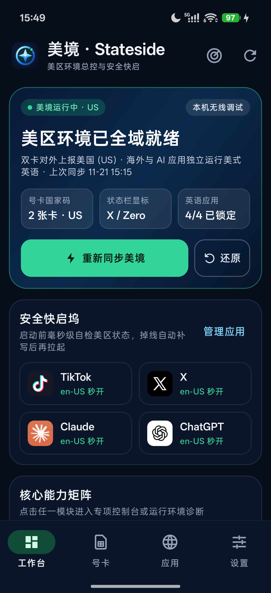
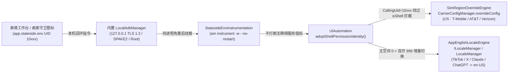

<div align="center">

# 美境 · Stateside

**Android 14 ~ 17 免 Root 一体化美区电话卡环境与海外 / AI 应用原生英语工作台**

[](LICENSE)
[-3DDC84?logo=android&logoColor=white)](https://developer.android.com)
[](#构建与核验)
[](https://github.com/Chiiz0/Stateside/actions/workflows/android-ci.yml)
[](https://github.com/Chiiz0/Stateside/releases)

**简体中文** | [English](README_EN.md) · [技术架构解析](docs/ARCHITECTURE.md) · [国产系统设置指南](docs/OEM_SETUP_GUIDE.md) · [常见问题排查](docs/FAQ.md)

</div>

---

## 为什么做「美境（Stateside）」？

在国内国产中文手机上使用 **TikTok、X (Twitter)、Claude、ChatGPT** 等海外社交与 AI 工具时，以往往往需要同时折腾 **3 款独立极客工具**（`Shizuku` + `Simlet / Nrfr` + `Per-App Language`），不仅授权链路割裂，且自 **Android 15 QPR / Android 16（CVE-2025-48617 安全补丁）** 起，Google 在系统电话框架中硬性封锁了 `shell` UID 调用 `CarrierConfigManager.overrideConfig`，导致传统基于 Shizuku Shell 的改卡工具直接抛出 `SecurityException: overrideConfig cannot be invoked by shell` 失效。

**美境（Stateside）** 将整套能力浓缩为普通用户**点一下就能用**的单个零依赖应用：

| 对比维度 | 传统极客三件套方案 | 美境（Stateside）一体化方案 |
| :--- | :--- | :--- |
| **所需安装应用** | Shizuku + 运营商修改器 + 应用语言管理（3 个 App） | **仅 1 个自包含轻量安装包（~6 MB）** |
| **Android 15 QPR / 16 / 17 兼容** | 受 `CVE-2025-48617` 拦截报错失效 | **同进程 `Instrumentation` 借权原生突破** |
| **状态栏运营商显示** | 普通卡被强改或「全球通钻卡」5G 显标卡死改不动 | **默认无痕保留原运营商；亦支持分卡独立自定义（如 `X`），原生穿透移动 5G 尊享显标锁定** |
| **手机全局系统语言** | 常需手动切英文或逐个进系统深层设置 | **系统照常保持简体中文，目标应用自动锁定 `en-US`（兼容 Play 动态分包）** |
| **应用双开 / 分身支持** | 易漏改或跨空间误强停 | **自动识别主空间与分身空间（如 `user 999`）按需增量切换** |
| **重启掉线防护** | 重启后忘记重开即暴露国内 SIM 卡锁区 | **Wi-Fi 就绪自动静默补写 + 桌面带 `US` 角标防漏改快捷方式** |
| **校园网 / 全局 VPN 兼容** | 组播被拦截时卡死在扫描配对页 | **支持回环 `EADDRINUSE` 寻端 + 通知栏手填「端口 配对码」直连** |

---

## 界面预览与核心特性

<table>
  <tr>
    <td width="34%" align="center">
      
    </td>
    <td width="66%" valign="top">
      <h3>五大开箱即用能力</h3>
      <ol>
        <li><b>四大核心应用默认勾选 + 自由扩展</b>：开箱自动纳管 <b>TikTok</b>（含全球版/亚太版/Lite）、<b>X</b>、<b>Claude</b>、<b>ChatGPT</b>，支持从应用抽屉自由添加任意其他应用；跨空间比对语言变更，未变更时绝不强停打断 AI 对话。</li>
        <li><b>完全自包含无线调试 + Root 双通道</b>：内置本机 <code>127.0.0.1</code> TLS 1.3 + SPAKE2 配对客户端；已 Root（Magisk / KernelSU / APatch）机型自动走免配对直通快车道。</li>
        <li><b>国产 ROM 精准向导与自动定位</b>：自动识别澎湃 HyperOS、ColorOS、OriginOS、MagicOS、One UI，一键跳转并高亮滚动至「无线调试」条目。</li>
        <li><b>安全快启坞 + 桌面防漏改守卫图标</b>：支持生成带目标应用真实图标与 <code>US</code> 盾牌角标的桌面快捷方式——美区生效时 0.1 秒无感直达；重启回落时当场拦截并 2 秒自动恢复美境后再放行。</li>
        <li><b>两步干净还原国内默认</b>：基于硬件 MCC/MNC（移动/联通/电信/广电/港澳台）先覆盖回真实运营商名再清空覆盖层，即刻恢复原卡与系统中文。</li>
      </ol>
    </td>
  </tr>
</table>

---

## 1 分钟首次激活上手

1. 前往 [Releases 页面](https://github.com/Chiiz0/Stateside/releases) 下载最新 `Stateside-v1.4.0-release.apk` 安装并打开，点击顶部提示授予**电话状态、通知与本地网络权限**。
2. 点击主界面 **「开始 1 分钟首次激活」**：
   - 先按向导红框提示开启当前品牌唯一必开的附加开关（见下表）；
   - 点击 **「启动配对雷达并跳转『无线调试』」**，打开「无线调试」（勾选*始终允许在此网络上调试*），点开 **「使用配对码配对设备」**。
3. **保持弹窗不关闭**，直接下拉手机顶部通知栏，在美境通知中点击 **「提交配对码」** 输入屏幕上的 6 位数字，即自动完成绑定并开启美境！

### 各品牌手机必开附加开关速查

| 手机品牌 / 系统 | 开发者选项内必开附加开关 | 详细图文与保活说明 |
| :--- | :--- | :--- |
| **小米 / REDMI（澎湃 HyperOS）** | 开启 **「USB 调试（安全设置）」**（滑到底部点三次允许） | [查看澎湃指南](docs/OEM_SETUP_GUIDE.md#1-小米--redmi澎湃-hyperos) |
| **OPPO / 一加 / 真我（ColorOS）** | **ColorOS 16/17 仅开「无线调试」即可**（旧版 14/15 按需开启底部「禁止权限监控」） | [查看 ColorOS 指南](docs/OEM_SETUP_GUIDE.md#2-oppo--一加--真我coloros-14--15--16--17) |
| **vivo / iQOO（OriginOS）** | 同时开启 **「USB 调试」+「无线调试」** | [查看 OriginOS 指南](docs/OEM_SETUP_GUIDE.md#3-vivo--iqoooriginos) |
| **荣耀（MagicOS）** | 开启 **「“仅充电”模式下允许 ADB 调试」** | [查看 MagicOS 指南](docs/OEM_SETUP_GUIDE.md#4-荣耀magicos) |
| **三星（One UI）** | 关闭「安全与隐私 → **自动拦截器（Auto Blocker）**」 | [查看 One UI 指南](docs/OEM_SETUP_GUIDE.md#5-三星one-ui) |
| **Google Pixel / 原生类原生** | 仅开启 **「无线调试」** 即可 | [查看原生指南](docs/OEM_SETUP_GUIDE.md#6-google-pixel--原生与类原生-aosp) |

---

## 工作原理架构图



> 深入技术实现细节（含 `CVE-2025-48617` 绕过机制、`targetSdk 36` 回环 `EADDRINUSE` 寻端算法、空白 `EF_SPN` 国产卡两步还原状态机及 `JobScheduler` Wi-Fi 开机自愈）请参阅 **[docs/ARCHITECTURE.md](docs/ARCHITECTURE.md)**。

---

## 隐私与安全承诺

- **100% 纯本机回环通信**：Manifest 中声明的 `INTERNET` 权限**仅用于连接本机 `127.0.0.1` 回环无线调试端口**，应用内无任何外网请求域名、无任何统计 SDK、无任何遥测上报。
- **非持久化内存级改卡（零变砖风险）**：所有运营商参数均通过系统官方 `CarrierConfigManager.overrideConfig(..., persistent = false)` 在内存会话层覆盖，不触碰基带 NVRAM / EFS 分区；随时可一键两步还原，或重启手机自然复原。
- **设备加密存储隔离**：本机无线调试配对私钥以 `0600` 权限保存在 `DeviceProtectedStorage` 的 `noBackupFilesDir` 中，禁止云端备份导出。详见 **[SECURITY.md](SECURITY.md)**。

---

## 构建与核验

环境要求：**JDK 17+**（推荐 JDK 21）与 **Android SDK API 36**。

```bash
# 克隆仓库
git clone https://github.com/Chiiz0/Stateside.git
cd Stateside

# 执行单元测试并同时构建 Debug 与 R8 精简签名版 Release APK
./gradlew testDebugUnitTest :app:assembleDebug :app:assembleRelease

# 核验 Android 15 / 16 / 17 真机 16 KB 内存页对齐要求
$ANDROID_HOME/build-tools/36.1.0/zipalign -c -P 16 4 app/build/outputs/apk/release/app-release.apk
```

编译产物位于 `app/build/outputs/apk/release/app-release.apk`。

---

## 项目结构

```text
app/src/main/java/app/stateside/env/
├── adb/          # 本机 127.0.0.1 TLS 1.3 + SPAKE2 配对服务、回环端口寻端雷达与断线重连管理
├── privileged/   # 同进程 Instrumentation 借权入口、双卡美区覆盖引擎与多空间 en-US 语言引擎
├── boot/         # Direct Boot 接收器与绑定 TRANSPORT_WIFI 约束的开机自愈 JobService
├── shortcut/     # 毫秒级环境状态核验与动态合成「真实图标 + US 角标」桌面守卫快捷方式
├── oem/          # 小米/OPPO/vivo/荣耀/三星机型识别、必开开关提示与「无线调试」高亮定位跳转
├── data/         # 基于 DeviceProtectedStorage 与 BOOT_COUNT 的会话状态存储
├── model/        # 运营商预设、四大默认核心英语应用组、MCC/MNC 归属地字典与配对码解析器
└── ui/           # Jetpack Compose Material 3 主工作台、首次激活向导、应用选择器与透明拦截页
```

---

## 参与贡献与开源协议

欢迎提交 Issue 反馈真机 ROM 适配情况或提交 Pull Request！参与开发前请阅读 **[CONTRIBUTING.md](CONTRIBUTING.md)**。

本项目基于 **[Apache License 2.0](LICENSE)** 开源，第三方组件与架构致谢详见 **[NOTICE](NOTICE)**。
