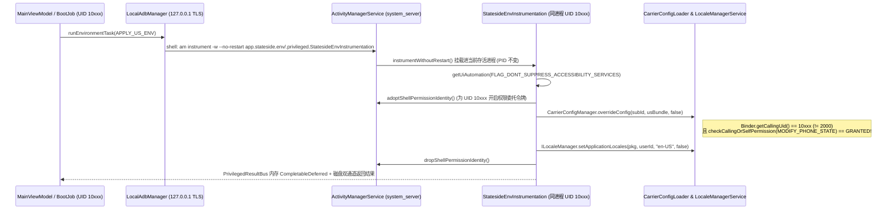

# 美境（Stateside）核心技术架构深度解析

本文档详细阐述 `app.stateside.env` 如何在 **免 Root、免电脑、免安装外部 Shizuku** 的前提下，于 **Android 14 ~ 17（API 34 ~ 37）** 真机上完成本机无线调试配对、突破 `CVE-2025-48617` 电话框架限制、跨用户空间增量切换 `en-US` 以及实现重启自动自愈。

---

## 1. 攻克 Android 15 QPR / 16 / 17 的 `CVE-2025-48617` 限制

### 1.1 背景：为什么传统 Shizuku 改卡工具失效了？

自 2025 年 10 月 Android 安全补丁（跟踪编号 **CVE-2025-48617**）合入 Android 15 QPR 与 Android 16 / 17 后，AOSP 在 `CarrierConfigLoader.overrideConfig()` 中新增了针对调用方 UID 的硬性检查：

```java
// AOSP packages/services/Telephony/.../CarrierConfigLoader.java
if (Binder.getCallingUid() == Process.SHELL_UID) {
    throw new SecurityException("overrideConfig cannot be invoked by shell");
}
```

传统的非 Root 改卡工具通过 Shizuku 在 `uid=2000 (shell)` 进程中发起 Binder 调用，因 `CallingUid == 2000` 被直接拦截抛出异常。

### 1.2 美境的同进程 `Instrumentation` 权限委托架构

美境利用 Android 官方公开测试与自动化框架机制，实现了**调用者 UID 仍为普通应用 `10xxx`，同时合法持有 `MODIFY_PHONE_STATE` 与 `CHANGE_CONFIGURATION` 权限**：



三大关键工程细节：
1. **同进程免重启（`--no-restart`）**：若不携带 `--no-restart`，`ActivityManagerService` 会在启动和结束 `Instrumentation` 时强杀 `app.stateside.env` 主进程，导致 UI 闪退且正在等待结果的本机 ADB Socket 中断。携带 `--no-restart` 后，系统通过 `IApplicationThread.instrumentWithoutRestart` 直接挂载进当前存活的 UI/后台进程，全程 PID 保持不变。
2. **保护用户无障碍服务（`FLAG_DONT_SUPPRESS_ACCESSIBILITY_SERVICES`）**：默认 `getUiAutomation()` 会断开手机上正在运行的无障碍服务（如李跳跳、GKD、密码自动填充器）。显式传入该标志位后，用户日常无障碍工具零受影响。
3. **防半连接态崩溃保护**：当国产 ROM 因未开启安全调试开关拒绝 `UiAutomation` 握手时，`Instrumentation.mUiAutomation` 可能停留在 `CONNECTION_STATE_CONNECTING` 状态，此时直接调用 `finish()` 会在内部 `disconnect()` 抛出 `IllegalStateException` 导致进程崩溃。美境在异常分支先清理残余连接引用再安全结束。

---

## 2. 本机 `127.0.0.1` 无线调试与回环 `EADDRINUSE` 寻端算法

### 2.1 为什么常规 mDNS 本机过滤在 `targetSdk 36` 真机上会失效？

许多开源无线 ADB 库通过 `NetworkInterface.getNetworkInterfaces()` 枚举本机网卡 IP，再与 `NsdServiceInfo.getHostAddresses()` 比对字符串来判断发现的 `_adb-tls-pairing._tcp` 是否属于本机。但在 Android 14 ~ 17 真机上存在两大陷阱：
1. **SELinux `NETLINK_ROUTE` 封锁**：当 `targetSdk >= 30` 时，非特权应用调用 `getNetworkInterfaces()` 会触发 SELinux 拦截并抛出 `SocketException`，导致本机 IP 集合退化为仅含 `127.0.0.1`，而 `adbd` 广播的是局域网 IP（如 `192.168.1.105`），造成 **100% 漏检**。
2. **IPv6 作用域后缀差异**：网卡枚举返回的 IPv6 常带 `%wlan0`，而 NSD 解析出的地址不含后缀，字符串判等恒为 `false`。

### 2.2 回环端口占用探测（Loopback `EADDRINUSE` Probe）

`AdbMdnsDiscovery` 采用零接触回环绑定探测：
- 当 NSD 发现局域网内有设备广播端口 `P` 时，尝试在 `127.0.0.1:P` 与 `[::1]:P` 执行一次 `ServerSocket.bind(..., reuseAddress = false)` 并立即关闭。
- 若抛出 `IOException (EADDRINUSE)`，说明**当前这台手机的内核正在监听端口 `P`**——100% 确认为本机 `adbd`，既无需枚举受限网卡，也不会向 `adbd` 发起客户端 TCP 连接干扰 SPAKE2 配对状态机。
- 同时辅以 `ConnectivityManager.getLinkProperties(activeNetwork)` 原始字节数组（`ByteArray`）比对，以及支持通知栏直接手填 `端口 6位配对码`（应对校园网 AP 隔离或全局 VPN `tun` 拦截组播）。

---

## 3. 两步干净还原国内电话卡状态机

当用户点击「一键恢复国内默认状态」时，若仅简单调用 `overrideConfig(subId, null, false)`：
1. `SubscriptionManagerService` 在部分版本中不会立即重算内存中的 `countryIso`；
2. 许多国内移动/联通/电信 USIM 卡芯片内的 `EF_SPN` 字段为空白，若此前更新过 `gsm.sim.operator.alpha`，直接清空会导致运营商显示名依旧残留为 `T-Mobile`。

美境采用严格的两步闭环还原（`SimRegionOverrideEngine.restoreAllSimsToRealCountry`）：
1. **第一步（真实归属地写回与异步轮询）**：读取硬件只读的 `TelephonyManager.getSimOperator()`（如 `46000`），通过 `MccIsoResolver` 反推真实国家码（`cn`）与真实运营商名（`中国移动`），显式写入一次 `overrideConfig` 并轮询等待异步 `Phone` Handler 将 `simCountryIso` 与 `simOperatorName` 刷新到位；
2. **第二步（彻底移除会话覆盖层）**：再次调用 `overrideConfig(subId, null, false)` 释放全部覆盖键值，使系统完全回归原生出厂策略。

---

## 4. 国产系统应用双开（Clone Profile）与跨空间增量强停

国产系统（澎湃 HyperOS、ColorOS、OriginOS）普遍支持微信等应用双开，系统内会常驻一个克隆用户空间（通常为 `user 999`）。

若直接对所有用户空间统一校验 `userIds.all { getLocales(pkg, uid) == "en-US" }`：
- 当用户双开了微信（存在 `user 999`），但并未双开 Claude 时，查询 `user 999` 下的 Claude 语言始终返回空串 `""`；
- 这会导致每次校验均被误判为「尚未全部处于 `en-US`」，进而每次开机自愈都误调 `forceStopPackage` 强杀用户正在对话的 Claude / ChatGPT！

`AppEnglishLocaleEngine` 通过 `getPackageInfoAsUser(pkg, 0, userId)` 逐空间过滤实际安装了该应用的用户 ID，并独立比对每个已安装空间的修改前后语言标签，**仅当至少一个已安装空间确实发生了语言变更时**才执行一次重载。

---

## 5. `BOOT_COUNT` 会话核验与 `JobScheduler` Wi-Fi 延迟自愈

1. **防无权限误放行**：在 `DeviceProtectedStorage` 中记录每次成功写入美境时的系统 `Settings.Global.BOOT_COUNT`。当用户尚未授予 `READ_PHONE_STATE` 权限时，仅当当前系统 `BOOT_COUNT` 与上次写入时严格一致才认定美境在线；一旦手机重启（`BOOT_COUNT + 1`），桌面快捷方式与主界面立即进入待恢复拦截态。
2. **攻克开机 Wi-Fi 慢关联**：真机重启后通常需 5 ~ 30 秒才会关联上路由器并启动无线调试 TLS 服务，远超 `BroadcastReceiver.goAsync()` 的 10 秒上限。`BootRestoreReceiver` 在开机广播中向系统 `JobScheduler` 注册绑定 `NetworkCapabilities.TRANSPORT_WIFI` 约束的 `BootRestoreJobService`，无论用户何时解锁或连上 Wi-Fi，系统都会第一时间唤醒完成静默补写。

---

## 6. 穿透 5G SA 核心网 NITZ 尊享显标（如「中国移动全球通钻卡」）的状态栏定制机制

在开通了运营商 5G 尊享显标（3GPP TS 24.501 `CONFIGURATION UPDATE COMMAND` / NITZ `Full name for network`，如「中国移动全球通钻卡」）的号卡上：
1. 基站侧直接将 `CellIdentityNr.mAlphaLong` 与 `ServiceState.mOperatorAlphaLong` 置为定制名称；
2. 部分国产 ROM（如 ColorOS 的 `1001_CMCC` 配置）默认开启 `config_carrier_support_nitz = true`，并在 `CarrierDisplayNameResolver (CDNR)` 中命中 `rule=1`（`showSpn = false, showPlmn = true`）。若仅覆盖 `carrier_name_string (EF_SPN)`，`spn` 虽变但因 `showSpn = false` 被隐藏，状态栏仍显示锁死的基站 `plmn`。

美境支持两种精细化策略：
- **默认无痕模式（`US_KEEP_CARRIER`）**：仅写入 `sim_country_iso_override_string = "us"`，确保海外与 AI 应用识别为美区卡的同时，100% 保留状态栏原生运营商或尊享显标；
- **全局 / 分卡自定义显示模式（如单独将卡 1 设为 `X`）**：在 `CarrierConfig` 会话层协同注入 `pnn_override_string_array`（3GPP `EF_PNN` 首选网络全称/简称，在 AOSP `CDNR.getCarrierDisplayNameFromEf()` 中优先级高于 `ServiceState.getOperatorAlpha()`）、清空 `opl_override_opl_string_array`、绑定当前注册 `ehplmn_override_string_array` + `force_home_network_bool = true`、设定单一显示位掩码 `spn_display_condition_override_int = 1` 并关闭 `config_carrier_support_nitz = false`，从而在不触碰基带分区的纯内存层干净接管状态栏与控制中心运营商文案。
